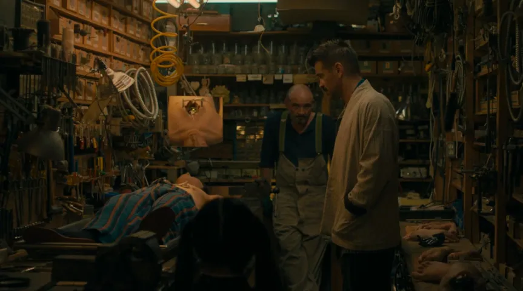

The After Yang is a movie about the loss and grieving of a robot that was adopted by family which they will try to fix it but the process they will realize how much they loved it.

> Science fiction can often be the perfect genre to explore what it means to be human

## Review

| Detail | Value |
| --- | --- |
| Year | 2021 |
| IMDb | 6.6 |
| Mine | 8 |
| Director | Kogonada |
| DP | Benjamin Loeb |

## Story and Dialogues

I liked it, it seemed boring at first and slow paced. It slowly gets better, the dialogues get incredibly amazing the closer you get to the ending.

The inciting incident kicks in very early in the movie although the movie is about Yang we know nothing about it. slowly toward the end while the family tries to fix it and they one by one review their memories with it and realize how they had feelings for it was just amazing.

Many great dialogues about life and what it means to be human. What i liked in particular about the ending was the portrayal of loss and grieving. I liked how the grief was depicted, it was slow and calm no sudden.

## Camera Work

Something special about this movie which i noticed very quickly was that when they speak the camera does not switch to a (ots) medium or close up shot. it just stays as long shot and lets us explore the environment with long takes.

## Vibe, Mood and Color

A high contrast movie. It had film grain in it which made it feel really natural and organic. Something straight out of nature.

And I noticed quite a lot of yellow in this movie as far i know yellow is a color for danger and stress.
And a lot of green too. but overall it wasn't on a specific color as i mentioned it had a high contrast and film grain vibe.
